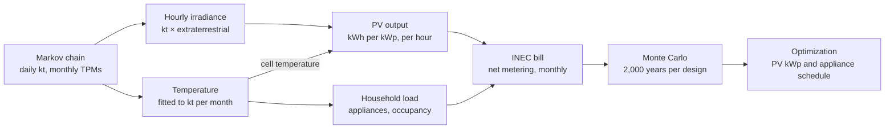
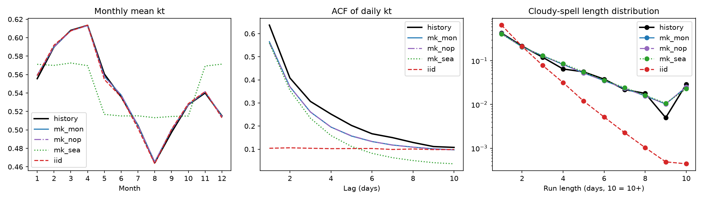
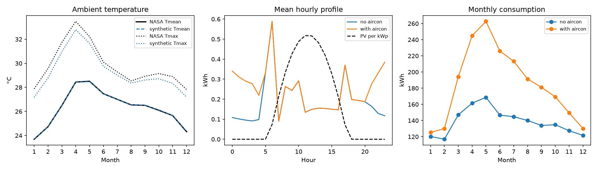
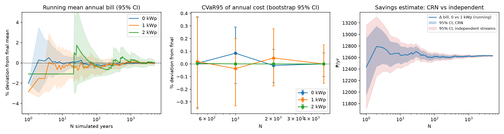
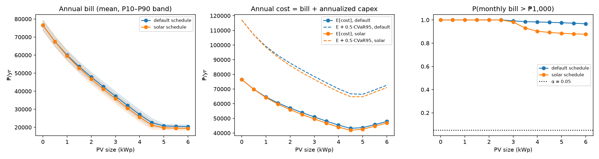
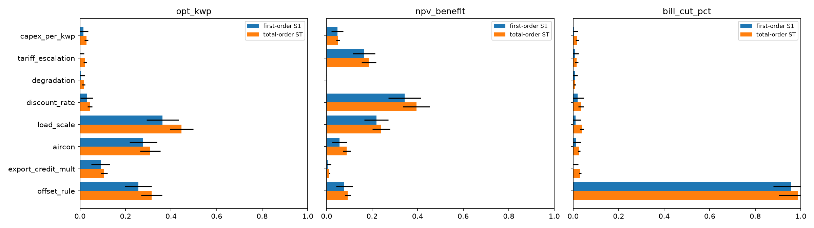

# Stochastic Optimization of Household Monthly Electricity Bills Under Solar Variability: A Markov Chain and Monte Carlo Approach in Ilocos Norte, Philippines

*Draft* · 20 October 2026

> Exported from the online draft: https://claude.ai/code/artifact/dc259200-ecef-4f18-863d-83d8cc7eb7ab
> Charts link to the matching figures in `results/`.

## Abstract

For a Batac City household with aircon and two INEC bills (September 2026: 464 kWh, ₱5,739.45; October 2026: 509 kWh, ₱6,295.52), a 4.5 kWp rooftop PV system without battery cuts the modelled annual bill from ₱76,534 to about ₱21,300 (−72%), saving about ₱55,000 a year with a simple payback of about 3.7 years, assuming exports are credited at the generation charge only. A risk-averse household should choose 5.0 kWp, which lowers the worst-5% monthly bill from about ₱3,350 to ₱2,630 for about ₱680 a year more in expected cost. This study reaches that figure with a stochastic simulation instead of an average-sunshine calculation, because a net-metered bill is a non-linear, path-dependent function of the weather.

Daily solar clearness index (kt) is modelled as a month-conditioned Markov chain fitted to 24 years (2001–2024) of NASA POWER data for Batac City. The chain reproduces the observed monthly means within ±0.7% and the length of cloudy spells (KS test p = 0.76). A temperature model fitted to the same record links PV output to cooling demand. A bottom-up household load model and a line-by-line reconstruction of the INEC unbundled tariff with net metering convert each simulated year into monthly peso bills. A Monte Carlo engine with common random numbers runs 2,000 simulated years per design, a count set by a convergence study.

Three findings stand out. For this aircon household, ignoring day-to-day persistence of cloudy weather changes the bill distribution by less than 1%, because seasonal and night-time demand dominate the bill; for a small, no-aircon household it understates the worst 5% of monthly bills by about 6%. The optimal PV size depends mostly on household consumption, aircon ownership and the net-metering credit rule, not on installed cost or panel degradation (Sobol total-order indices 0.45, 0.31 and 0.31). The first-year bill reduction is decided almost entirely by which charges the export credit may offset (index 0.99), which makes confirming that rule against real INEC bills the most important remaining step.

## Chapter 1. Introduction

### 1.1 Background

Ilocos Norte has some of the strongest solar resource in Luzon, and residential rates from the Ilocos Norte Electric Cooperative (INEC) reached ₱11.72/kWh in April 2026. Under the Renewable Energy Act (RA 9513) and the ERC net-metering rules, a household with rooftop PV uses its own solar first and exports the surplus, which is credited at the utility's blended generation cost rather than the full retail rate.

### 1.2 Problem statement

A household's monthly bill under net metering is a non-linear, path-dependent function of the sequence of sunny and cloudy days. Three features cause this:

1. Self-consumed solar saves the full retail rate, while exported solar earns only the generation rate.
2. The unbundled tariff has a fixed metering charge, per-kWh riders and taxes that do not scale in a simple way.
3. Cloudy days cluster in runs, especially during the habagat and typhoon season.

As a result, the expected bill is not the bill of an average-weather year:

$$
\mathbb{E}[\text{bill}] \neq \text{bill}(\mathbb{E}[\text{irradiance}])
$$

A deterministic sizing calculation from average monthly irradiance therefore misestimates both the expected bill and the high-bill months that households feel most.

### 1.3 Objectives

**General objective.** Develop and validate a stochastic simulation–optimization framework that finds the PV size minimizing the expected and risk-adjusted electricity cost of an Ilocos Norte household.

**Specific objectives.**

1. Build and validate a month-conditioned Markov chain generator of the daily clearness index for Ilocos Norte from NASA POWER data, and measure how much ignoring day-to-day cloud persistence biases the bill distribution.
2. Implement a Monte Carlo engine that combines the solar generator, a temperature-coupled household demand model and the INEC unbundled tariff with net metering to produce the distribution of monthly peso bills for each PV size.
3. Determine the optimal PV size (and appliance schedule) under risk-neutral and risk-adjusted objectives, identify the uncertain inputs that drive the result through sensitivity analysis, and check the model against real bills.

### 1.4 Research questions

1. How much does ignoring day-to-day persistence of cloudiness bias the estimated bill distribution?
2. How does the optimal PV size change when the objective includes a risk term?
3. Which uncertain input contributes most to the variance of the optimal size and the savings?

### 1.5 Scope and delimitations

- The study sizes **grid-tied rooftop PV only**. Battery storage is excluded.
- The site is **Batac City** (18.055°N, 120.566°E), where the household is located. Laoag City shares the same NASA POWER grid cell (its download was byte-identical), so a separate Laoag series adds no information and is not used.
- Hourly irradiance is derived from daily kt with a simplified disaggregation, not the Aguiar–Collares-Pereira TAG method.
- PV output uses a PVWatts-style model on horizontal irradiance, not the full pvlib transposition chain.
- Lifeline and senior-citizen discounts are not modelled.
- **Household demand is calibrated from two billing months, September and October 2026** (464 kWh, ₱5,739.45 and 509 kWh, ₱6,295.52; ₱12.3574/kWh unbundled rate on both; one INEC residential account in Batac City). These were the only household billing records available to the researcher during data collection (see Section 2.1). The other ten months are extrapolated from the model's temperature-driven seasonal load pattern.

These simplifications are revisited as limitations in Chapter 5.

## Chapter 2. Data

All model inputs come from three sources: satellite-derived weather, INEC's published tariff, and household bills.

| Data | Source | Coverage | Used for |
| --- | --- | --- | --- |
| Daily clearness index, surface and top-of-atmosphere irradiance | [NASA POWER](https://power.larc.nasa.gov/) daily API | Batac City (18.055°N, 120.566°E), 2001–2024, 8,766 days, none missing | Markov chain, PV output |
| Daily mean, maximum and minimum 2 m temperature | NASA POWER daily API | same | Temperature model, cooling load |
| Residential unbundled rate schedule, all line items | [INEC URS, January 2020](https://inec-ec.com/wp-content/uploads/2020/01/URS-January-2020.pdf) | 17 per-kWh lines, VAT lines, ₱5 metering charge, franchise taxes | Tariff structure |
| All-in residential rate and transmission charge | [Daily Tribune, 9 April 2026](https://tribune.net.ph/2026/04/09/inec-cites-fuel-costs-weak-peso-behind-april-power-rate-hike) | ₱11.7246/kWh all-in; ₱1.5476/kWh transmission | Updating the tariff to 2026 |
| Household monthly bill | Researcher's own INEC bill (one residential account, Batac City) | September 2026: 464 kWh, ₱5,739.45; October 2026: 509 kWh, ₱6,295.52 | Calibrating demand and rate; back-testing |
| Appliance inventory | Representative engineering assumptions | 11 appliances | Hourly load shape |

**Tariff update.** The April 2026 generation rate was not published in the sources found. It is solved as ₱6.0848/kWh, the value that makes the January 2020 line structure, with the 2026 transmission charge, reproduce the reported ₱11.7246/kWh total. All other lines keep their 2020 values until a current bill confirms them.

### 2.1 Why only two billing months are used

The household data are limited to the September and October 2026 bills because they were the only billing records available when data were collected (October 2026):

1. **Timing of data collection.** The study's data-gathering period covered the September 2026 billing cycle (reading date 18 September 2026, due 27 September 2026) and the October 2026 cycle (18 September–18 October 2026, reading date 18 October 2026, due 27 October 2026). They were the two most recent, complete bills on hand.
2. **Only the current bill is printed.** INEC's field-printed thermal statement shows the current month's reading and charges (September: previous reading 856, kWh used 464; October: readings 1,320 to 1,829, kWh used 509). It does not list a 12-month consumption history, so earlier months cannot be read from it.
3. **Earlier statements were not kept.** Paper statements are given at the meter reading and usually discarded after payment. Statements for previous months were not retained by the household.
4. **No accessible online history.** No online account or consumption-history record was available to the researcher for this account, and requesting historical ledger data from the cooperative was outside the study's time frame.
5. **Thermal paper degrades.** Even when older receipts are kept, the thermal print fades within months, so older statements are often unreadable.

The household also reports that September 2026 was unusually hot for the season. October 2026, however, used 10% more electricity than September (509 vs 464 kWh), while the load model expects October to be about 7% lower. So September was not an unusually high month for this household (see Sections 4.7 and 5.3).

Because of this, the two months are used as **calibration anchors**: they fix the household's consumption level and actual all-in rate, and both billed months are reproduced exactly. The seasonal shape for the remaining ten months comes from the load model (Section 3.4), scaled so that its September plus October total equals the two bills. The approach is designed to work with one or a few bills, which is the usual situation for a household considering solar for the first time. Results should therefore be read as an illustration of the method for one household, not as a precise annual forecast.

**Known data limitations.** NASA POWER temperature represents a roughly 50 km grid cell and may run cooler than ground stations; the difference is usually largest at night. The nearest PAGASA synoptic station is in Laoag, about 16 km north of Batac. PAGASA Laoag station records were not obtained for bias correction.

## Chapter 3. Methodology

The model is a five-layer pipeline in which one daily weather sequence drives both solar supply and household demand, so their correlation emerges from the data rather than being assumed.



The same daily kt sets irradiance and temperature; temperature feeds both PV cell losses and cooling load, and each simulated year ends as twelve monthly bills.

### 3.1 Solar model: Markov chain of the clearness index

The clearness index removes the known geometry of the sun, so the chain models only the random part of the weather:

$$
k_t = \frac{GHI}{H_0}
$$

- **States.** Daily kt is divided into 6 equal-probability states with edges 0.42, 0.52, 0.58, 0.62 and 0.66.
- **Transition matrices.** One matrix per calendar month, estimated by maximum likelihood:

$$
\hat{p}_{ij} = \frac{n_{ij}}{\sum_j n_{ij}}
$$

- **Order test.** First- versus second-order dependence is tested with a likelihood-ratio chi-square test, AIC and BIC.
- **Within-state value.** A day's kt is drawn from the historical values seen in that state and month. Its position within the state follows a Gaussian AR(1) process with fitted ρ = 0.075.
- **Hourly irradiance.** Hourly kt is daily kt multiplied by lognormal noise (σ = 0.15), capped at 0.85, then multiplied by hourly extraterrestrial irradiance for latitude 18.055°N (Batac).

### 3.2 PV output

AC energy per installed kWp uses a PVWatts-style model with NOCT cell temperature:

$$
P = \text{kWp} \cdot \frac{GHI}{1000} \cdot \left[1 + \gamma (T_c - 25)\right] \cdot 0.86, \qquad T_c = T_a + GHI \cdot \frac{NOCT - 20}{800}
$$

with γ = −0.004 /°C, NOCT = 45 °C, and a 0.86 derate for inverter, soiling, wiring and availability losses.

### 3.3 Temperature model

For each month m, daily mean temperature and daily range depend on that day's kt:

$$
T_d = a_m + b_m (k_{t,d} - \bar{k}_{t,m}) + e_d, \qquad DTR_d = c_m + d_m (k_{t,d} - \bar{k}_{t,m}) + u_d
$$

The residual e follows an AR(1) process with monthly φ between 0.63 and 0.83. Hourly temperature follows cosine segments with the minimum at 06:00 and the maximum at 14:00.

### 3.4 Household demand model

- **Occupancy.** An hourly two-state Markov chain (home and active, or away) with persistence 0.8, separate weekday and weekend profiles, and a random sleep window (bed 21:00–23:00, wake 04:00–06:00).
- **Appliances.** Eleven appliances in five classes: fixed (refrigerator, standby), occupancy-driven (lighting, TV), cooking (rice cooker), temperature-driven (three fans, optional 1 hp inverter aircon) and shiftable (washing machine, water pump, flat iron).
- **Temperature coupling.** Fans switch on with temperature. The refrigerator draws 3% more per °C above 27 °C. An aircon owner runs it overnight when it is still at least 26.5 °C at 21:00.
- **Shiftable loads.** Each runs at its usual hour, or on the "solar" schedule at 11:00, within its allowed window.
- **Calibration to bills.** Simulated load is scaled month by month to the household's billed kWh. With fewer than 12 bills, the missing months follow the model's own seasonal pattern, scaled so its total over the billed months equals the bills; each billed month keeps its real kWh.

### 3.5 Billing model

The INEC residential bill is rebuilt from 17 per-kWh lines, pass-through VAT lines, 12% VAT and franchise taxes on distribution charges, and a ₱5 monthly metering charge. Net metering credits exported kWh at the generation rate, applies the credit to the bill, and carries any unused credit forward. Because the exact offset rule was not confirmed, two scenarios are run: the credit may offset all variable charges ("bill"), or generation charges only ("generation").

### 3.6 Monte Carlo engine

- **Common random numbers.** Every PV size and schedule is evaluated on the same simulated years.
- **Seeding.** One master seed is split into a seed per batch of 500 years, and each batch seed into separate streams for weather, temperature and load. Changing the load model cannot change the sampled weather.
- **Replications.** N = 2,000 simulated years, set by the convergence study in Chapter 4.

### 3.7 Optimization

The design space is PV size from 0 to 6 kWp in 0.5 kWp steps, crossed with the two appliance schedules (simulation–optimization by grid search). Annual cost is the annual bill plus annualized capital cost (₱45,000/kWp placeholder, 8% discount rate, 20-year life). Three objectives are compared:

$$
\begin{aligned}
&\text{(1) risk-neutral:} && \min \; \mathbb{E}[C] \\
&\text{(2) mean--CVaR:} && \min \; \mathbb{E}[C] + \lambda \, \mathrm{CVaR}_{95}[C], \quad \lambda = 0.5 \\
&\text{(3) chance-constrained:} && \min \; \mathbb{E}[C] \;\; \text{s.t.} \;\; P(\text{monthly bill} > X) \le \alpha
\end{aligned}
$$

### 3.8 Sensitivity analysis

Sobol indices are estimated with SALib (Saltelli sampling, N = 512, giving 5,120 model runs of 200 simulated years each). Each run evaluates a 20-year PV life with tariff escalation and panel degradation.

| Input | Range |
| --- | --- |
| Installed cost | ₱35,000–60,000 per kWp |
| Tariff escalation | 0–5% per year |
| Panel degradation | 0.3–0.8% per year |
| Discount rate | 5–12% |
| Household consumption | 0.7–1.4 × modelled household |
| Aircon ownership | no / yes |
| Export credit rate | 0.8–1.2 × generation rate |
| Credit offset rule | whole bill / generation only |

### 3.9 Basis of the formulas

Every formula in the model follows an established method:

| Formula | Code | Source |
| --- | --- | --- |
| Markov chain of daily clearness-index states | `src/markov.py` | Aguiar, Collares-Pereira & Conde (1988) |
| Transition probabilities by maximum likelihood, p̂ᵢⱼ = nᵢⱼ / nᵢ; likelihood-ratio test of chain order | `src/estimate_tpm.py` | Anderson & Goodman (1957) |
| Hourly disaggregation of daily kt (simplified) | `src/markov.py` | Aguiar & Collares-Pereira (1992) |
| Extraterrestrial irradiance H₀ = 1361·(1 + 0.033 cos(2πd/365))·cos θz; declination δ = 23.45°·sin(2π(284 + d)/365) | `src/markov.py` | Duffie & Beckman (2013, Ch. 1); Cooper (1969) |
| Cell temperature T_cell = T_amb + G·(NOCT − 20)/800 | `src/pv.py` | Duffie & Beckman (2013, Ch. 23) |
| PV output P = (G/1000)·[1 + γ(T_cell − 25)]·derate, γ = −0.004/°C | `src/pv.py` | Dobos (2014) |
| Unbundled bill and net-metering credit | `src/tariff.py` | INEC (2020); ERC Res. 09 s.2013; RA 9513 |
| Common random numbers | `src/simulation.py` | Law (2015, Ch. 11) |
| CVaR₉₅ = mean of the worst 5% of outcomes | `src/simulation.py` | Rockafellar & Uryasev (2000) |
| Capital recovery factor r(1 + r)ⁿ / ((1 + r)ⁿ − 1) | `src/optimization.py` | Duffie & Beckman (2013, Ch. 11) |
| Sobol first- and total-order indices | `src/sensitivity.py` | Saltelli et al. (2010); Herman & Usher (2017) |
| Verification and validation framework (Section 4.7) | `tests/test_model.py` | Sargent (2013) |

## Chapter 4. Results

### 4.1 Weather: the Markov chain reproduces Batac's record

A first-order chain is sufficient. The likelihood-ratio test of first against second order gives p = 0.50 (dry season) and p = 0.64 (wet season), and BIC prefers first order in both. Persistence differs by season: a heavily overcast day is followed by another 57% of the time in the wet season against 42% in the dry season.

Per-month matrices pass every validation test; pooling into two seasons, or drawing days independently, does not (2,000 simulated years against 24 observed years):

| Test | Per-month chain (used) | Two-season chain | Independent days |
| --- | --- | --- | --- |
| KS test, monthly-mean kt, dry season | p = 0.66 | p = 0.006 | p = 0.01 |
| KS test, monthly-mean kt, wet season | p = 0.75 | p = 0.81 | p = 0.04 |
| Monthly mean bias | within ±0.7% | −7.8% to +10.9% | within ±1% |
| Cloudy-spell length, KS test | p = 0.76 | p = 0.42 | p ≈ 10⁻⁴⁵ |
| P95 cloudy-spell length (record: 8 days) | 8 days | 7 days | 4 days |
| Lag-1 autocorrelation of daily kt (record: 0.64) | 0.56 | 0.56 | 0.10 |

The one shortfall is the lag-1 autocorrelation, about 0.07 below the record. Eight and ten states raise it only to 0.59 and 0.60 while thinning the monthly matrices, so 6 states are kept.



### 4.2 Temperature and demand

The fitted temperature model reproduces NASA monthly means within 0.1 °C, the daily range, the temperature–kt correlation (for example +0.64 in May) and the day-to-day variability (1.27 °C in both). Daily maxima run about 0.6 °C low because of the hourly cosine shape.

| Household | Mean use | Range by month | Share used 06:00–18:00 | Largest end uses |
| --- | --- | --- | --- | --- |
| No aircon | 139 kWh/month | 117 (Feb) to 169 (May) | 60% | refrigerator 24%, shiftable 18%, fans 17% |
| With aircon | 185 kWh/month | 125 (Jan) to 263 (May) | 45% | aircon 28%, refrigerator 18% |

The correlation between daytime load and PV output is weak (+0.17), because most cooling load falls at night.



### 4.3 Monte Carlo convergence

Two thousand simulated years hold every reported statistic within ±1% at 95% confidence. The binding statistic is the tail of the monthly bill:

| Statistic (1 kWp) | 95% CI half-width at N = 500 | at N = 2,000 |
| --- | --- | --- |
| Mean annual bill | ±0.32% | ±0.16% |
| CVaR95 of annual cost | ±0.36% | ±0.23% |
| P90 of the worst monthly bill | ±1.6% | ±0.7% |

Common random numbers cut the variance of the 0 versus 1 kWp savings estimate by a factor of 2.1. All 10 independent batches of 500 years select the same optimal size.



### 4.4 Optimal PV size and bill reduction

The household is the Batac City account in `data/bills/bills.csv`: two bills, September 2026 (464 kWh, ₱5,739.45) and October 2026 (509 kWh, ₱6,295.52), both ₱12.37/kWh all-in, with aircon. The model's default tariff underestimates both bills by 5.1% (back-test, test A), so all per-kWh rates are scaled by 1.054. The other ten months follow the model's seasonal pattern, giving 6,188 kWh a year (350 kWh in January to 736 kWh in May) and a modelled annual bill of ₱76,534 without solar (2,000 simulated years). Exports are credited at the generation charge only, the more conservative net-metering reading.



*Each 0.5 kWp cuts ₱4,400–9,000 off the annual bill up to 4.5 kWp and ₱1,600 for the step to 5.0 kWp; beyond that, each step saves only ₱150–175, because extra output is exported at the low generation credit.*

| PV size | Annual bill (solar schedule) | Saves per year | Bill cut | Payback | Worst-5% monthly bill |
| --- | --- | --- | --- | --- | --- |
| 0 kWp | ₱76,534 | — | — | — | ₱9,635 |
| 2.0 kWp | ₱46,740 | ₱29,795 | 39% | 3.0 years | ₱6,535 |
| 3.0 kWp | ₱35,858 | ₱40,677 | 53% | 3.3 years | ₱5,438 |
| 4.0 kWp | ₱25,691 | ₱50,843 | 66% | 3.5 years | ₱4,359 |
| **4.5 kWp** | **₱21,287** | **₱55,247** | **72%** | **3.7 years** | **₱3,350** |
| **5.0 kWp** | **₱19,674** | **₱56,860** | **74%** | **4.0 years** | **₱2,626** |
| 6.0 kWp | ₱19,351 | ₱57,183 | 75% | 4.7 years | ₱2,577 |

| Objective | Optimal design | Annual bill | Bill cut | Payback |
| --- | --- | --- | --- | --- |
| Risk-neutral, min E[cost] | 4.5 kWp, solar schedule | ₱21,287 | 72% | 3.7 years |
| Mean–CVaR, λ = 0.5 | 5.0 kWp, solar schedule | ₱19,674 | 74% | 4.0 years |
| Chance-constrained, P(month > ₱1,000) ≤ 0.05 | infeasible up to 6 kWp | — | — | — |

The risk-neutral objective chooses 4.5 kWp. Below it, each extra 0.5 kWp still replaces imports at the full ₱12.37/kWh; above it, the added output is mostly exported at the generation credit, so savings flatten while payback lengthens. The mean–CVaR objective chooses 5.0 kWp: the step from 4.5 to 5.0 kWp saves only ₱1,613 a year, less than its ₱2,292 annualized cost, so expected cost rises by ₱679 a year, but the worst-5% monthly bill falls from ₱3,350 to ₱2,626 and the CVaR95 of annual cost falls by ₱1,454. The ₱1,000 monthly-bill target cannot be met at any size: with aircon, most cooling load falls at night when PV produces nothing, and without a battery that night-time energy is always bought from the grid (P(month > ₱1,000) = 0.89 at 4.5 kWp). Moving washing, pumping and ironing to 11:00 saves a further ₱1,282 a year at 4.5 kWp at no cost.

**Monthly bill with 4.5 kWp** (solar schedule, generation-only credit, mean of 2,000 simulated years; `src/monthly.py`, `results/monthly_bill.csv`). Only September and October are observed bills; the other months are model estimates.

| Month | kWh used | Bill without solar | Bill with 4.5 kWp | Reduced by | Cut |
| --- | --- | --- | --- | --- | --- |
| Jan | 350 | ₱4,329 | ₱1,035 | ₱3,293 | 76% |
| Feb | 365 | ₱4,511 | ₱1,056 | ₱3,455 | 77% |
| Mar | 538 | ₱6,657 | ₱1,650 | ₱5,007 | 75% |
| Apr | 686 | ₱8,483 | ₱2,270 | ₱6,213 | 73% |
| May | 736 | ₱9,104 | ₱2,662 | ₱6,442 | 71% |
| Jun | 634 | ₱7,838 | ₱2,428 | ₱5,409 | 69% |
| Jul | 595 | ₱7,364 | ₱2,274 | ₱5,090 | 69% |
| Aug | 532 | ₱6,574 | ₱1,969 | ₱4,605 | 70% |
| **Sep (billed)** | 464 | ₱5,739 | ₱1,570 | ₱4,170 | 73% |
| **Oct (billed)** | 509 | ₱6,296 | ₱1,851 | ₱4,444 | 71% |
| Nov | 416 | ₱5,150 | ₱1,391 | ₱3,759 | 73% |
| Dec | 363 | ₱4,489 | ₱1,130 | ₱3,359 | 75% |
| **Year** | 6,188 | ₱76,534 | ₱21,287 | ₱55,247 | 72% |

The 4.5 kWp system produces about 6,699 kWh a year: 2,192 kWh is used directly at home and 4,507 kWh is exported for credit. About 3,996 kWh a year is still imported, mostly night-time aircon. The largest peso reductions fall in April and May, the hottest months.

If the export credit may instead offset the whole bill, savings keep growing up to the 6 kWp limit (annual bill ₱6,030), so the size answer depends on the net-metering rule (Section 5.3). If September 2026 was 15% heat-inflated (about 403 kWh in a typical September), the annual load falls to 5,800 kWh and both objectives choose 4.5 kWp. Under the generation-only credit, 4.5–5.0 kWp is the robust range.

### 4.5 Effect of cloud persistence (research question 1)

The calibrated Batac household (6,188 kWh/yr, aircon, generation-only export credit) was simulated twice, both times calibrated to the same monthly kWh: once with the Markov chain and once with days drawn independently (i.i.d.). 2,000 simulated years each (`src/persistence.py`, `results/persistence.txt`).

| Monthly bill | 1 kWp Markov | 1 kWp i.i.d. | 4.5 kWp Markov | 4.5 kWp i.i.d. |
| --- | --- | --- | --- | --- |
| Mean | ₱4,999 | ₱5,000 | ₱1,881 | ₱1,880 |
| Standard deviation | ₱1,475 | ₱1,473 | ₱673 | ₱674 |
| P90 | ₱7,045 | ₱7,047 | ₱2,772 | ₱2,784 |
| CVaR95 (worst 5%) | ₱7,908 | ₱7,891 | ₱3,496 | ₱3,492 |

For this household, ignoring persistence changes every bill statistic by less than 1% at all sizes tested (1, 2, 3 and 4.5 kWp; at most 0.3%). The spread of its bills comes from the season, not the weather: monthly use swings from 350 kWh in January to 736 kWh in May, and much of it is night-time aircon that PV does not touch, so a run of cloudy days changes a ₱1,000–9,000 bill by little. For the model's generic household (about 300 kWh/month, no aircon), whose bill at 1 kWp is small and depends mostly on solar output, the same test understated the worst 5% of monthly bills by about 6%. Cloud persistence matters for the bill tail only when solar covers a large share of a small, daytime-heavy load.

### 4.6 Sensitivity analysis (research question 3)



*Household consumption sets the PV size; the discount rate sets the 20-year benefit (Sobol total-order indices).*

The Sobol runs vary inputs around the model's generic household (0.7–1.4 × its consumption, aircon yes or no), not the calibrated Batac household, so they show which inputs matter rather than the Batac size itself (mean optimum 1.9 kWp, P5–P95 1.0–3.0 kWp). Rerun on Batac data, the indices are unchanged.

The optimal size is a household question: consumption, aircon ownership and the credit rule together explain most of its variance, while installed cost (0.03) and degradation (0.01) barely matter. The 20-year benefit (mean ₱147,000, P5–P95 ₱64,000–268,000) depends mostly on the economic assumptions.

The first-year bill cut (mean 87%, P5–P95 71–100%) is explained almost entirely by the credit offset rule (total-order index 0.99). Panel degradation has no material effect on any output.

### 4.7 Verification and validation

The model was checked in two ways with an automated test suite (`tests/test_model.py`, 28 tests, all passing; run with `.venv/bin/python -m pytest tests -v`). **Verification** asks whether the code computes what the equations in Chapter 3 say ("is the model built right?"). **Validation** asks whether its output agrees with real data for Batac ("is it the right model?").

**Verification (20 tests).** Each check has a known correct answer, often worked by hand:

| Layer | What is checked |
| --- | --- |
| Markov chain | Every transition-matrix row sums to 1; the stationary distribution satisfies πP = π; simulated states and kt stay inside their bins; the calendar has 365 days; extraterrestrial irradiance is zero at night |
| PV output | Hand calculation: 1,000 W/m² at 30 °C gives 0.7353 kWh per kWp in that hour; zero irradiance gives zero output; a hotter panel produces less |
| Tariff | All-in rate equals the published ₱11.7246/kWh; 100 kWh without solar equals 100 × 11.7246 + ₱5.67 fixed charge; export credit carries forward and never pushes a bill below the fixed charge; generation-only offset is never cheaper over a year than whole-bill offset |
| Monte Carlo engine | Energy balance each month (import − export = load − PV); 0 kWp exports nothing; adding PV never raises the mean bill; the same seed reproduces the same result; changing aircon ownership leaves the sampled weather unchanged (common random numbers) |
| Calibration | After calibration the model reproduces the September 2026 bill exactly (464 kWh, ₱5,739.45), and with two bills reproduces both September and October 2026 (509 kWh, ₱6,295.52) |

**Validation (8 tests).** Model output is compared against independent data with a stated pass condition:

| Comparison | Pass condition | Result |
| --- | --- | --- |
| Monthly-mean kt, synthetic vs 24 years of NASA POWER | within 3% every month | within 0.8% |
| Lag-1 autocorrelation of daily kt | within 0.10 of the record | 0.565 vs 0.637 |
| Same test on independent (i.i.d.) days, as a check that the test can fail | must fail | 0.10 vs 0.64 (fails) |
| Month-to-month variability of kt | within 25% of the record | 0.040 vs 0.043 |
| Annual PV yield | 1,300–1,650 kWh/kWp (typical for Northern Luzon) | about 1,490 |
| Dry-season vs wet-season PV output | dry higher | yes |
| Published tariff (uncalibrated) vs real September 2026 bill | error below 10% | 5.1% (₱5,446 vs ₱5,739) |
| Uncalibrated monthly load | household scale (150–900 kWh) | yes |

The weather and PV layers are validated against independent records. The published tariff is also within 5.1% of the October 2026 bill (₱5,973 vs ₱6,296). The second bill allows a first out-of-sample check of the seasonal load pattern (back-test C in `src/backtest.py`). Calibrated on September, the model predicts 430 kWh for October against 509 kWh billed (−15%). Calibrated on October, it predicts 549 kWh for September against 464 kWh (+18%), a mean error of 16.8%. The model expects October use to fall as the weather cools, but this household's use rose. With both bills used for calibration, both months are reproduced exactly. The net-metering credit rule cannot yet be checked, because neither bill has solar (Section 5.3; back-test B). The split into verification and operational validation follows Sargent (2013).

## Chapter 5. Discussion and Limitations

### 5.1 Why risk-adjusted sizing often agrees with expected-value sizing

Net metering with credit carried forward acts as a buffer against bad weather. Surplus credit earned in sunny months pays for cloudy ones, so once a system covers most of the annual demand, the high-bill tail almost disappears. For the Batac household the risk term changes the optimum by one step, from 4.5 to 5.0 kWp. At 4.5 kWp the system still leaves a high-bill tail in the hot, high-use months (May–July), and the extra 0.5 kWp trims it (worst-5% monthly bill ₱3,350 → ₱2,626) at a small expected cost (₱679 a year). Beyond 5.0 kWp the tail stops shrinking, because the remaining bill is night-time aircon use, which PV cannot reach without storage. With only the September bill (5,677 kWh/yr) or a heat-adjusted September, both objectives chose 4.5 kWp, so this result depends on how much the household uses in the peak months. This buffering effect is itself a finding: under current Philippine rules, weather risk matters most for undersized systems, and households whose demand falls mainly at night keep a bill floor that extra panels cannot remove.

### 5.2 What drives the answer

The optimal size is a question about the household, not the hardware. Consumption, aircon ownership and the credit rule explain most of its variance, while installed cost barely moves it, because payback is short across the whole ₱35,000–60,000/kWp range. The 20-year benefit, by contrast, is driven by the economic assumptions: discount rate, consumption and tariff escalation.

### 5.3 Limitations

- **Net-metering credit rule not confirmed.** The single most influential input was run as two scenarios because no net-metered INEC bill was available.
- **Tariff partly derived.** The 2026 generation rate is solved from a reported total; other lines use January 2020 values.
- **Appliance and occupancy assumptions.** The hourly load shape is representative, not surveyed or metered; monthly totals come from real bills.
- **Simplified hourly irradiance and PV model.** Lognormal disaggregation replaces TAG, and a PVWatts-style model on horizontal irradiance replaces the pvlib chain, so panel tilt and orientation are not represented.
- **Weather persistence slightly low.** The chain's lag-1 autocorrelation is about 0.07 below the record, although cloudy-spell lengths match.
- **Temperature source.** NASA POWER grid-cell temperature may run cooler than the PAGASA Laoag station (nearest ground record), which mainly affects aircon use.
- **Two billing months (September and October 2026).** Only two bills were available (Section 2.1), so the following limits apply:
  - *Annual load is mostly modelled.* Only 2 of 12 months are observed; 6,188 kWh/yr is an extrapolation from the seasonal load model.
  - *Possibly anomalous September.* The household reports that September 2026 was unusually hot. The October bill weakens this concern: October used 10% more than September, while the model expects it to be about 7% lower, so September does not stand out as a high month for this household. As a check, if heat added 15% to September (a typical September of about 403 kWh), the annual load falls from 6,188 to 5,800 kWh and both objectives choose 4.5 kWp (generation-only export credit). PAGASA Laoag station temperatures for September–October 2026 would settle whether both months were hotter than usual.
  - *Climate trend not modelled.* The weather and temperature models are fitted to NASA POWER 2001–2024 and assume a stationary climate. Warming beyond that record, including hotter-than-usual months such as the one reported here, is not represented, so future cooling demand may be understated and solar savings correspondingly understated.
  - *Understated uncertainty.* The P10/P90 bands reflect weather variability only, not month-to-month variation in household behaviour, so the true spread is wider.
  - *Rate fixed at one point in time.* ₱12.3574/kWh is the rate on both the September and October 2026 bills. INEC's generation charge changes monthly, so savings and payback may differ in other months.
  - *Limited hourly and seasonal validation.* The bills give only monthly totals, so the hourly load shape (which governs self-consumption without storage) cannot be checked. Predicting one billed month from the other misses by 16.8% on average (Section 4.7), and the model's September-to-October drop is not seen in the bills, so the estimated kWh for the ten unbilled months is uncertain by at least this much. With both bills used for calibration, no independent month is left for out-of-sample validation.
  - *Single household.* Results describe one account and are not generalised to Ilocos Norte households.
- **Out of scope.** Battery storage and lifeline or senior-citizen discounts.
- **Credit carry-over between years** is not modelled; each simulated year starts with zero credit.

### 5.4 Remaining work

- [x] Back-test the tariff against the researcher's own INEC bills (`src/backtest.py`, test A): the default 2026 tariff is 5.1% below both the September and October 2026 bills.
- [x] Add a second month for the same account (October 2026) and test the seasonal extrapolation out of sample (test C): mean error 16.8%.
- [ ] Obtain one net-metered INEC bill to settle the credit rule (test B).
- [ ] Obtain PAGASA Laoag station (nearest to Batac) daily temperatures for September–October 2026 and compare with the 2001–2024 means to confirm whether the billed months were anomalously hot.
- [ ] Collect a dry-season month (ideally April or May) for the same account to test the seasonal extrapolation at peak demand.
- [ ] Collect bills from 3–5 more households and report the MAPE.
- [ ] Replace the ₱45,000/kWp placeholder with a local installer quote.

## Chapter 6. Conclusion and Recommendations

A month-conditioned Markov chain and Monte Carlo framework shows that the Batac City household (September and October 2026 bills: 464 and 509 kWh, ₱5,739.45 and ₱6,295.52, with aircon) is best served by 4.5–5.0 kWp of rooftop PV without battery. At 4.5 kWp the modelled annual bill falls by about 72% (₱76,534 to ₱21,287), saving about ₱55,000 a year with a payback near 3.7 years; 5.0 kWp cuts it by 74% with a 4.0-year payback and a lower worst-month bill. The remaining bill is mostly night-time aircon use, which PV without storage cannot cover. Given that only two months are billed, 4.5–5.0 kWp is the recommended range.

Answers to the research questions:

1. **Cloud persistence.** Independent-day sampling halves the length of extreme cloudy spells, but for the Batac aircon household this changes the bill distribution by less than 1%, because seasonal and night-time demand dominate its bill. For a small no-aircon household, the worst 5% of monthly bills are understated by about 6%.
2. **Risk-adjusted sizing.** For this household it adds one step to the expected-value size (5.0 vs 4.5 kWp), trimming the worst months at a small expected cost. Beyond that, net-metering credit absorbs bad-weather months, and the remaining risk is night-time load that more PV cannot reduce.
3. **Dominant uncertainty.** Household consumption drives the optimal size; the net-metering credit rule drives the bill reduction; the discount rate drives the long-run benefit.

**Recommendations.**

- Households should size PV from their own billed consumption and aircon use, not from a generic kWp figure.
- Running washing, pumping and ironing at midday is a free addition to any PV system.
- INEC and the ERC should publish the net-metering settlement rule in plain terms, since it changes household savings by up to a quarter.
- Future work should add measured hourly load data, ground-station irradiance, and a full pvlib model with roof orientation.

## References

- NASA Langley Research Center. [POWER Project daily data API](https://power.larc.nasa.gov/). Accessed October 2026.
- Ilocos Norte Electric Cooperative. [Unbundled Rate Schedule, January 2020 billing](https://inec-ec.com/wp-content/uploads/2020/01/URS-January-2020.pdf).
- Daily Tribune. [INEC cites fuel costs, weak peso behind April power rate hike](https://tribune.net.ph/2026/04/09/inec-cites-fuel-costs-weak-peso-behind-april-power-rate-hike). 9 April 2026.
- Energy Regulatory Commission. [Resolution No. 09, Series of 2013: Net-Metering Rules](https://lpr.adb.org/resource/net-metering-program-renewable-energy-energy-regulatory-commission-resolution-no-09-series).
- Republic Act No. 9513, Renewable Energy Act of 2008.
- Aguiar, R. and Collares-Pereira, M. (1992). TAG: a time-dependent, autoregressive, Gaussian model for generating synthetic hourly radiation. *Solar Energy* 49(3).
- Herman, J. and Usher, W. (2017). SALib: an open-source Python library for sensitivity analysis. *Journal of Open Source Software* 2(9).
- Aguiar, R. J., Collares-Pereira, M., and Conde, J. P. (1988). Simple procedure for generating sequences of daily radiation values using a library of Markov transition matrices. *Solar Energy* 40(3), 269–279.
- Anderson, T. W. and Goodman, L. A. (1957). Statistical inference about Markov chains. *Annals of Mathematical Statistics* 28(1), 89–110. https://doi.org/10.1214/aoms/1177707039
- Cooper, P. I. (1969). The absorption of radiation in solar stills. *Solar Energy* 12(3), 333–346.
- Dobos, A. P. (2014). *PVWatts Version 5 Manual* (NREL/TP-6A20-62641). National Renewable Energy Laboratory.
- Duffie, J. A. and Beckman, W. A. (2013). *Solar Engineering of Thermal Processes* (4th ed.). Wiley.
- Law, A. M. (2015). *Simulation Modeling and Analysis* (5th ed.). McGraw-Hill.
- Rockafellar, R. T. and Uryasev, S. (2000). Optimization of conditional value-at-risk. *Journal of Risk* 2(3), 21–41.
- Saltelli, A., Annoni, P., Azzini, I., Campolongo, F., Ratto, M., and Tarantola, S. (2010). Variance based sensitivity analysis of model output. Design and estimator for the total sensitivity index. *Computer Physics Communications* 181(2), 259–270. https://doi.org/10.1016/j.cpc.2009.09.018
- Sargent, R. G. (2013). Verification and validation of simulation models. *Journal of Simulation* 7(1), 12–24. https://doi.org/10.1057/jos.2012.20

## Appendix: Running the model

All code is in `src/`, run from the project root:

```
python3 -m venv .venv && .venv/bin/pip install -r requirements.txt
.venv/bin/python -m src.fetch_nasa_power          # download weather data
.venv/bin/python -m src.estimate_tpm batac 6      # fit Markov chain
.venv/bin/python -m src.validate_generator 2000   # Chapter 4.1
.venv/bin/python -m src.validate_load 500         # Chapter 4.2
.venv/bin/python -m src.convergence 5000 500      # Chapter 4.3
.venv/bin/python -m src.optimization --kwh 464 509 --pesos 5739.45 6295.52 --month 9 10 --aircon --offset generation   # Chapter 4.4
.venv/bin/python -m src.monthly --kwh 464 509 --pesos 5739.45 6295.52 --month 9 10 --aircon --kwp 4.5   # Chapter 4.4 monthly table
.venv/bin/python -m src.persistence --kwh 464 509 --pesos 5739.45 6295.52 --month 9 10 --aircon --offset generation   # Chapter 4.5
.venv/bin/python -m src.sensitivity 512 200       # Chapter 4.6
.venv/bin/python -m src.backtest                  # back-test against data/bills/bills.csv
.venv/bin/python -m pytest tests -v               # Chapter 4.7 (verification and validation)
```
