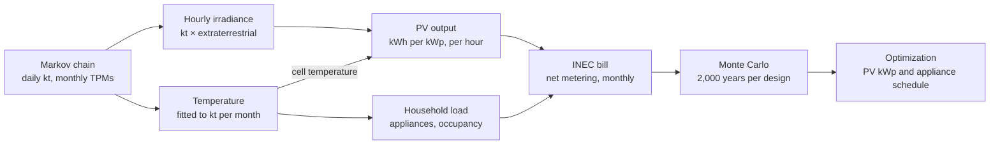

# Stochastic Optimization of Household Monthly Electricity Bills Under Solar Variability: A Markov Chain and Monte Carlo Approach in Ilocos Norte, Philippines

*Draft* · 10 October 2026

> Exported from the online draft: https://claude.ai/code/artifact/dc259200-ecef-4f18-863d-83d8cc7eb7ab
> Charts link to the matching figures in `results/`.

## Abstract

For a Batac City household with aircon and a September 2026 INEC bill of ₱5,739.45 (464 kWh), a 4.5 kWp rooftop PV system without battery cuts the modelled annual bill from ₱70,225 to about ₱18,000 (−74%), saving about ₱52,000 a year with a simple payback of about 3.9 years, assuming exports are credited at the generation charge only. This study reaches that figure with a stochastic simulation instead of an average-sunshine calculation, because a net-metered bill is a non-linear, path-dependent function of the weather.

Daily solar clearness index (kt) is modelled as a month-conditioned Markov chain fitted to 24 years (2001–2024) of NASA POWER data for Batac City. The chain reproduces the observed monthly means within ±0.7% and the length of cloudy spells (KS test p = 0.76). A temperature model fitted to the same record links PV output to cooling demand. A bottom-up household load model and a line-by-line reconstruction of the INEC unbundled tariff with net metering convert each simulated year into monthly peso bills. A Monte Carlo engine with common random numbers runs 2,000 simulated years per design, a count set by a convergence study.

Three findings stand out. For this aircon household, ignoring day-to-day persistence of cloudy weather changes the bill distribution by less than 1%, because seasonal and night-time demand dominate the bill; for a small, no-aircon household it understates the worst 5% of monthly bills by about 6%. The optimal PV size depends mostly on household consumption, aircon ownership and the net-metering credit rule, not on installed cost or panel degradation (Sobol total-order indices 0.45, 0.31 and 0.31). The first-year bill reduction is decided almost entirely by which charges the export credit may offset (index 0.99), which makes confirming that rule against real INEC bills the most important remaining step.

## Chapter 1. Introduction

### 1.1 Background

Ilocos Norte has some of the strongest solar resource in Luzon, and residential rates from the Ilocos Norte Electric Cooperative (INEC) reached ₱11.72/kWh in April 2026. Under the Renewable Energy Act (RA 9513) and the ERC net-metering rules, a household with rooftop PV uses its own solar first and exports the surplus, which is credited at the utility's blended generation cost rather than the full retail rate.

### 1.2 Problem statement

A household's monthly bill under net metering is a non-linear, path-dependent function of the sequence of sunny and cloudy days. Three features cause this:

1. Self-consumed solar saves the full retail rate, while exported solar earns only the generation rate.
2. The unbundled tariff has a fixed metering charge, per-kWh riders and taxes that do not scale in a simple way.
3. Cloudy days cluster in runs, especially during the habagat and typhoon season.

As a result, the expected bill is not the bill of an average-weather year:

$$
\mathbb{E}[\text{bill}] \neq \text{bill}(\mathbb{E}[\text{irradiance}])
$$

A deterministic sizing calculation from average monthly irradiance therefore misestimates both the expected bill and the high-bill months that households feel most.

### 1.3 Objectives

**General objective.** Develop and validate a stochastic simulation–optimization framework that finds the PV size minimizing the expected and risk-adjusted electricity cost of an Ilocos Norte household.

**Specific objectives.**

1. Build and validate a month-conditioned Markov chain generator of the daily clearness index for Ilocos Norte from NASA POWER data, and measure how much ignoring day-to-day cloud persistence biases the bill distribution.
2. Implement a Monte Carlo engine that combines the solar generator, a temperature-coupled household demand model and the INEC unbundled tariff with net metering to produce the distribution of monthly peso bills for each PV size.
3. Determine the optimal PV size (and appliance schedule) under risk-neutral and risk-adjusted objectives, identify the uncertain inputs that drive the result through sensitivity analysis, and check the model against real bills.

### 1.4 Research questions

1. How much does ignoring day-to-day persistence of cloudiness bias the estimated bill distribution?
2. How does the optimal PV size change when the objective includes a risk term?
3. Which uncertain input contributes most to the variance of the optimal size and the savings?

### 1.5 Scope and delimitations

- The study sizes **grid-tied rooftop PV only**. Battery storage is excluded.
- The site is **Batac City** (18.055°N, 120.566°E), where the household is located. Laoag City shares the same NASA POWER grid cell (its download was byte-identical), so a separate Laoag series adds no information and is not used.
- Hourly irradiance is derived from daily kt with a simplified disaggregation, not the Aguiar–Collares-Pereira TAG method.
- PV output uses a PVWatts-style model on horizontal irradiance, not the full pvlib transposition chain.
- Lifeline and senior-citizen discounts are not modelled.
- **Household demand is calibrated from a single billing month, September 2026** (464 kWh, ₱5,739.45, ₱12.3574/kWh unbundled rate; one INEC residential account in Batac City). This was the only household billing record available to the researcher during data collection (see Section 2.1). The other eleven months are extrapolated from the model's temperature-driven seasonal load pattern.

These simplifications are revisited as limitations in Chapter 5.

## Chapter 2. Data

All model inputs come from three sources: satellite-derived weather, INEC's published tariff, and household bills.

| Data | Source | Coverage | Used for |
| --- | --- | --- | --- |
| Daily clearness index, surface and top-of-atmosphere irradiance | [NASA POWER](https://power.larc.nasa.gov/) daily API | Batac City (18.055°N, 120.566°E), 2001–2024, 8,766 days, none missing | Markov chain, PV output |
| Daily mean, maximum and minimum 2 m temperature | NASA POWER daily API | same | Temperature model, cooling load |
| Residential unbundled rate schedule, all line items | [INEC URS, January 2020](https://inec-ec.com/wp-content/uploads/2020/01/URS-January-2020.pdf) | 17 per-kWh lines, VAT lines, ₱5 metering charge, franchise taxes | Tariff structure |
| All-in residential rate and transmission charge | [Daily Tribune, 9 April 2026](https://tribune.net.ph/2026/04/09/inec-cites-fuel-costs-weak-peso-behind-april-power-rate-hike) | ₱11.7246/kWh all-in; ₱1.5476/kWh transmission | Updating the tariff to 2026 |
| Household monthly bill | Researcher's own INEC bill (one residential account, Batac City) | September 2026 only: 464 kWh, ₱5,739.45 | Calibrating demand and rate; back-testing |
| Appliance inventory | Representative engineering assumptions | 11 appliances | Hourly load shape |

**Tariff update.** The April 2026 generation rate was not published in the sources found. It is solved as ₱6.0848/kWh, the value that makes the January 2020 line structure, with the 2026 transmission charge, reproduce the reported ₱11.7246/kWh total. All other lines keep their 2020 values until a current bill confirms them.

### 2.1 Why only one billing month is used

The household data are limited to the September 2026 bill because it was the only billing record available when data were collected (October 2026):

1. **Timing of data collection.** The study's data-gathering period coincided with the September 2026 billing cycle (reading date 18 September 2026, due 27 September 2026). It was the most recent, complete bill on hand.
2. **Only the current bill is printed.** INEC's field-printed thermal statement shows the current month's reading and charges (previous reading 856, kWh used 464). It does not list a 12-month consumption history, so earlier months cannot be read from it.
3. **Earlier statements were not kept.** Paper statements are given at the meter reading and usually discarded after payment. Statements for previous months were not retained by the household.
4. **No accessible online history.** No online account or consumption-history record was available to the researcher for this account, and requesting historical ledger data from the cooperative was outside the study's time frame.
5. **Thermal paper degrades.** Even when older receipts are kept, the thermal print fades within months, so older statements are often unreadable.

The household also reports that September 2026 was unusually hot for the season. This makes the single month informative about peak cooling demand, but it may not represent a typical September (see Section 5.3).

Because of this, the single month is used as a **calibration anchor**: it fixes the household's consumption level and actual all-in rate for September 2026. The seasonal shape for the remaining months comes from the load model (Section 3.4). The approach is designed to work when only one bill exists, which is the usual situation for a household considering solar for the first time. Results should therefore be read as an illustration of the method for one household, not as a precise annual forecast.

**Known data limitations.** NASA POWER temperature represents a roughly 50 km grid cell and may run cooler than ground stations; the difference is usually largest at night. The nearest PAGASA synoptic station is in Laoag, about 16 km north of Batac. PAGASA Laoag station records were not obtained for bias correction.

## Chapter 3. Methodology

The model is a five-layer pipeline in which one daily weather sequence drives both solar supply and household demand, so their correlation emerges from the data rather than being assumed.



The same daily kt sets irradiance and temperature; temperature feeds both PV cell losses and cooling load, and each simulated year ends as twelve monthly bills.

### 3.1 Solar model: Markov chain of the clearness index

The clearness index removes the known geometry of the sun, so the chain models only the random part of the weather:

$$
k_t = \frac{GHI}{H_0}
$$

- **States.** Daily kt is divided into 6 equal-probability states with edges 0.42, 0.52, 0.58, 0.62 and 0.66.
- **Transition matrices.** One matrix per calendar month, estimated by maximum likelihood:

$$
\hat{p}_{ij} = \frac{n_{ij}}{\sum_j n_{ij}}
$$

- **Order test.** First- versus second-order dependence is tested with a likelihood-ratio chi-square test, AIC and BIC.
- **Within-state value.** A day's kt is drawn from the historical values seen in that state and month. Its position within the state follows a Gaussian AR(1) process with fitted ρ = 0.075.
- **Hourly irradiance.** Hourly kt is daily kt multiplied by lognormal noise (σ = 0.15), capped at 0.85, then multiplied by hourly extraterrestrial irradiance for latitude 18.055°N (Batac).

### 3.2 PV output

AC energy per installed kWp uses a PVWatts-style model with NOCT cell temperature:

$$
P = \text{kWp} \cdot \frac{GHI}{1000} \cdot \left[1 + \gamma (T_c - 25)\right] \cdot 0.86, \qquad T_c = T_a + GHI \cdot \frac{NOCT - 20}{800}
$$

with γ = −0.004 /°C, NOCT = 45 °C, and a 0.86 derate for inverter, soiling, wiring and availability losses.

### 3.3 Temperature model

For each month m, daily mean temperature and daily range depend on that day's kt:

$$
T_d = a_m + b_m (k_{t,d} - \bar{k}_{t,m}) + e_d, \qquad DTR_d = c_m + d_m (k_{t,d} - \bar{k}_{t,m}) + u_d
$$

The residual e follows an AR(1) process with monthly φ between 0.63 and 0.83. Hourly temperature follows cosine segments with the minimum at 06:00 and the maximum at 14:00.

### 3.4 Household demand model

- **Occupancy.** An hourly two-state Markov chain (home and active, or away) with persistence 0.8, separate weekday and weekend profiles, and a random sleep window (bed 21:00–23:00, wake 04:00–06:00).
- **Appliances.** Eleven appliances in five classes: fixed (refrigerator, standby), occupancy-driven (lighting, TV), cooking (rice cooker), temperature-driven (three fans, optional 1 hp inverter aircon) and shiftable (washing machine, water pump, flat iron).
- **Temperature coupling.** Fans switch on with temperature. The refrigerator draws 3% more per °C above 27 °C. An aircon owner runs it overnight when it is still at least 26.5 °C at 21:00.
- **Shiftable loads.** Each runs at its usual hour, or on the "solar" schedule at 11:00, within its allowed window.
- **Calibration to bills.** Simulated load is scaled month by month to the household's billed kWh. With a single bill, the other months follow the model's own seasonal pattern.

### 3.5 Billing model

The INEC residential bill is rebuilt from 17 per-kWh lines, pass-through VAT lines, 12% VAT and franchise taxes on distribution charges, and a ₱5 monthly metering charge. Net metering credits exported kWh at the generation rate, applies the credit to the bill, and carries any unused credit forward. Because the exact offset rule was not confirmed, two scenarios are run: the credit may offset all variable charges ("bill"), or generation charges only ("generation").

### 3.6 Monte Carlo engine

- **Common random numbers.** Every PV size and schedule is evaluated on the same simulated years.
- **Seeding.** One master seed is split into a seed per batch of 500 years, and each batch seed into separate streams for weather, temperature and load. Changing the load model cannot change the sampled weather.
- **Replications.** N = 2,000 simulated years, set by the convergence study in Chapter 4.

### 3.7 Optimization

The design space is PV size from 0 to 6 kWp in 0.5 kWp steps, crossed with the two appliance schedules (simulation–optimization by grid search). Annual cost is the annual bill plus annualized capital cost (₱45,000/kWp placeholder, 8% discount rate, 20-year life). Three objectives are compared:

$$
\begin{aligned}
&\text{(1) risk-neutral:} && \min \; \mathbb{E}[C] \\
&\text{(2) mean--CVaR:} && \min \; \mathbb{E}[C] + \lambda \, \mathrm{CVaR}_{95}[C], \quad \lambda = 0.5 \\
&\text{(3) chance-constrained:} && \min \; \mathbb{E}[C] \;\; \text{s.t.} \;\; P(\text{monthly bill} > X) \le \alpha
\end{aligned}
$$

### 3.8 Sensitivity analysis

Sobol indices are estimated with SALib (Saltelli sampling, N = 512, giving 5,120 model runs of 200 simulated years each). Each run evaluates a 20-year PV life with tariff escalation and panel degradation.

| Input | Range |
| --- | --- |
| Installed cost | ₱35,000–60,000 per kWp |
| Tariff escalation | 0–5% per year |
| Panel degradation | 0.3–0.8% per year |
| Discount rate | 5–12% |
| Household consumption | 0.7–1.4 × modelled household |
| Aircon ownership | no / yes |
| Export credit rate | 0.8–1.2 × generation rate |
| Credit offset rule | whole bill / generation only |

## Chapter 4. Results

### 4.1 Weather: the Markov chain reproduces Batac's record

A first-order chain is sufficient. The likelihood-ratio test of first against second order gives p = 0.50 (dry season) and p = 0.64 (wet season), and BIC prefers first order in both. Persistence differs by season: a heavily overcast day is followed by another 57% of the time in the wet season against 42% in the dry season.

Per-month matrices pass every validation test; pooling into two seasons, or drawing days independently, does not (2,000 simulated years against 24 observed years):

| Test | Per-month chain (used) | Two-season chain | Independent days |
| --- | --- | --- | --- |
| KS test, monthly-mean kt, dry season | p = 0.66 | p = 0.006 | p = 0.01 |
| KS test, monthly-mean kt, wet season | p = 0.75 | p = 0.81 | p = 0.04 |
| Monthly mean bias | within ±0.7% | −7.8% to +10.9% | within ±1% |
| Cloudy-spell length, KS test | p = 0.76 | p = 0.42 | p ≈ 10⁻⁴⁵ |
| P95 cloudy-spell length (record: 8 days) | 8 days | 7 days | 4 days |
| Lag-1 autocorrelation of daily kt (record: 0.64) | 0.56 | 0.56 | 0.10 |

The one shortfall is the lag-1 autocorrelation, about 0.07 below the record. Eight and ten states raise it only to 0.59 and 0.60 while thinning the monthly matrices, so 6 states are kept.


### 4.2 Temperature and demand

The fitted temperature model reproduces NASA monthly means within 0.1 °C, the daily range, the temperature–kt correlation (for example +0.64 in May) and the day-to-day variability (1.27 °C in both). Daily maxima run about 0.6 °C low because of the hourly cosine shape.

| Household | Mean use | Range by month | Share used 06:00–18:00 | Largest end uses |
| --- | --- | --- | --- | --- |
| No aircon | 139 kWh/month | 117 (Feb) to 169 (May) | 60% | refrigerator 24%, shiftable 18%, fans 17% |
| With aircon | 185 kWh/month | 125 (Jan) to 263 (May) | 45% | aircon 28%, refrigerator 18% |

The correlation between daytime load and PV output is weak (+0.17), because most cooling load falls at night.


### 4.3 Monte Carlo convergence

Two thousand simulated years hold every reported statistic within ±1% at 95% confidence. The binding statistic is the tail of the monthly bill:

| Statistic (1 kWp) | 95% CI half-width at N = 500 | at N = 2,000 |
| --- | --- | --- |
| Mean annual bill | ±0.32% | ±0.16% |
| CVaR95 of annual cost | ±0.36% | ±0.23% |
| P90 of the worst monthly bill | ±1.6% | ±0.7% |

Common random numbers cut the variance of the 0 versus 1 kWp savings estimate by a factor of 2.1. All 10 independent batches of 500 years select the same optimal size.


### 4.4 Optimal PV size and bill reduction

The household is the Batac City account in `data/bills/bills.csv`: one September 2026 bill of 464 kWh and ₱5,739.45 (₱12.37/kWh all-in), with aircon. The model's default tariff underestimates this bill by 5.1% (back-test, test A), so all per-kWh rates are scaled by 1.054. The other eleven months follow the model's seasonal pattern, giving 5,677 kWh a year (321 kWh in January to 676 kWh in May) and a modelled annual bill of ₱70,225 without solar (2,000 simulated years). Exports are credited at the generation charge only, the more conservative net-metering reading.


*Each 0.5 kWp cuts ₱4,600–9,000 off the annual bill up to 4 kWp and ₱2,500 for the step to 4.5 kWp; beyond that, each step saves only ₱130–210, because extra output is exported at the low generation credit.*

| PV size | Annual bill (solar schedule) | Saves per year | Bill cut | Payback | Worst-5% monthly bill |
| --- | --- | --- | --- | --- | --- |
| 0 kWp | ₱70,225 | — | — | — | ₱8,841 |
| 2.0 kWp | ₱40,962 | ₱29,263 | 42% | 3.1 years | ₱5,795 |
| 3.0 kWp | ₱30,266 | ₱39,959 | 57% | 3.4 years | ₱4,717 |
| 4.0 kWp | ₱20,530 | ₱49,695 | 71% | 3.6 years | ₱3,341 |
| **4.5 kWp** | **₱18,056** | **₱52,170** | **74%** | **3.9 years** | **₱2,422** |
| 5.0 kWp | ₱17,845 | ₱52,381 | 75% | 4.3 years | ₱2,378 |
| 6.0 kWp | ₱17,564 | ₱52,661 | 75% | 5.1 years | ₱2,340 |

| Objective | Optimal design | Annual bill | Bill cut | Payback |
| --- | --- | --- | --- | --- |
| Risk-neutral, min E[cost] | 4.5 kWp, solar schedule | ₱18,056 | 74% | 3.9 years |
| Mean–CVaR, λ = 0.5 | 4.5 kWp, solar schedule | ₱18,056 | 74% | 3.9 years |
| Chance-constrained, P(month > ₱1,000) ≤ 0.05 | infeasible up to 6 kWp | — | — | — |

Both objectives choose 4.5 kWp. Below it, each extra 0.5 kWp still replaces imports at the full ₱12.37/kWh; above it, the added output is mostly exported at the generation credit, so savings flatten (+₱211 a year from 4.5 to 5.0 kWp) while payback lengthens. The ₱1,000 monthly-bill target cannot be met at any size: with aircon, most cooling load falls at night when PV produces nothing, and without a battery that night-time energy is always bought from the grid (P(month > ₱1,000) = 0.81 at 4.5 kWp). Moving washing, pumping and ironing to 11:00 saves a further ₱1,094 a year at 4.5 kWp at no cost.

If the export credit may instead offset the whole bill, savings keep growing up to the 6 kWp limit (annual bill ₱2,381), so the size answer depends on the net-metering rule (Section 5.3). If September 2026 was 15% heat-inflated, the optimum falls to 3.5–4.0 kWp. Across both cases, 3.5–4.5 kWp is the robust range.

### 4.5 Effect of cloud persistence (research question 1)

The calibrated Batac household (5,677 kWh/yr, aircon, generation-only export credit) was simulated twice, both times calibrated to the same monthly kWh: once with the Markov chain and once with days drawn independently (i.i.d.). 2,000 simulated years each (`src/persistence.py`, `results/persistence.txt`).

| Monthly bill | 1 kWp Markov | 1 kWp i.i.d. | 4.5 kWp Markov | 4.5 kWp i.i.d. |
| --- | --- | --- | --- | --- |
| Mean | ₱4,494 | ₱4,495 | ₱1,596 | ₱1,595 |
| Standard deviation | ₱1,336 | ₱1,334 | ₱466 | ₱463 |
| P90 | ₱6,338 | ₱6,341 | ₱2,238 | ₱2,232 |
| CVaR95 (worst 5%) | ₱7,131 | ₱7,118 | ₱2,519 | ₱2,505 |

For this household, ignoring persistence changes every bill statistic by less than 1% at all sizes tested (1, 2, 3 and 4.5 kWp; at most −0.6% in CVaR95 at 4.5 kWp). The spread of its bills comes from the season, not the weather: monthly use swings from 321 kWh in January to 676 kWh in May, and much of it is night-time aircon that PV does not touch, so a run of cloudy days changes a ₱1,500–7,000 bill by little. For the model's generic household (about 300 kWh/month, no aircon), whose bill at 1 kWp is small and depends mostly on solar output, the same test understated the worst 5% of monthly bills by about 6%. Cloud persistence matters for the bill tail only when solar covers a large share of a small, daytime-heavy load.

### 4.6 Sensitivity analysis (research question 3)


*Household consumption sets the PV size; the discount rate sets the 20-year benefit (Sobol total-order indices).*

The Sobol runs vary inputs around the model's generic household (0.7–1.4 × its consumption, aircon yes or no), not the calibrated Batac household, so they show which inputs matter rather than the Batac size itself (mean optimum 1.9 kWp, P5–P95 1.0–3.0 kWp). Rerun on Batac data, the indices are unchanged.

The optimal size is a household question: consumption, aircon ownership and the credit rule together explain most of its variance, while installed cost (0.03) and degradation (0.01) barely matter. The 20-year benefit (mean ₱147,000, P5–P95 ₱64,000–268,000) depends mostly on the economic assumptions.

The first-year bill cut (mean 87%, P5–P95 71–100%) is explained almost entirely by the credit offset rule (total-order index 0.99). Panel degradation has no material effect on any output.

## Chapter 5. Discussion and Limitations

### 5.1 Why risk-adjusted sizing often agrees with expected-value sizing

Net metering with credit carried forward acts as a buffer against bad weather. Surplus credit earned in sunny months pays for cloudy ones, so once a system covers most of the annual demand, the high-bill tail almost disappears. For the Batac household the risk term does not change the optimum (4.5 kWp under both objectives). Its remaining bill is night-time aircon use, which PV cannot reach without storage, so the bill tail is set by evening demand, not by cloudy weather. This buffering effect is itself a finding: under current Philippine rules, weather risk matters most for undersized systems, and households whose demand falls mainly at night keep a bill floor that extra panels cannot remove.

### 5.2 What drives the answer

The optimal size is a question about the household, not the hardware. Consumption, aircon ownership and the credit rule explain most of its variance, while installed cost barely moves it, because payback is short across the whole ₱35,000–60,000/kWp range. The 20-year benefit, by contrast, is driven by the economic assumptions: discount rate, consumption and tariff escalation.

### 5.3 Limitations

- **Net-metering credit rule not confirmed.** The single most influential input was run as two scenarios because no net-metered INEC bill was available.
- **Tariff partly derived.** The 2026 generation rate is solved from a reported total; other lines use January 2020 values.
- **Appliance and occupancy assumptions.** The hourly load shape is representative, not surveyed or metered; monthly totals come from real bills.
- **Simplified hourly irradiance and PV model.** Lognormal disaggregation replaces TAG, and a PVWatts-style model on horizontal irradiance replaces the pvlib chain, so panel tilt and orientation are not represented.
- **Weather persistence slightly low.** The chain's lag-1 autocorrelation is about 0.07 below the record, although cloudy-spell lengths match.
- **Temperature source.** NASA POWER grid-cell temperature may run cooler than the PAGASA Laoag station (nearest ground record), which mainly affects aircon use.
- **Single billing month (September 2026).** Only one bill was available (Section 2.1), so the following limits apply:
  - *Annual load is mostly modelled.* Only 1 of 12 months is observed; 5,677 kWh/yr is an extrapolation from the seasonal load model.
  - *Possibly anomalous month.* Climatologically, September in Ilocos Norte is a rainy, typhoon-season month, and the load model treats it as a moderate-demand month. The household, however, reports that September 2026 was unusually hot, consistent with the warming trend under climate change. If so, the 464 kWh reflects extra aircon and fan use that a typical September would not have. Since the other months are scaled up from September, a heat-inflated September would push every estimated month upward (March–June, 494–676 kWh, may be overestimated), and the recommended PV size would be biased upward. For example, if heat added 15% to the bill (a typical September of about 403 kWh), the estimated annual load falls from 5,677 to 4,931 kWh and the recommended size from 4.5 to 3.5–4.0 kWp (generation-only export credit). The reverse holds if September was in fact typical. Confirming this requires PAGASA Laoag station temperatures for September 2026 or a second bill.
  - *Climate trend not modelled.* The weather and temperature models are fitted to NASA POWER 2001–2024 and assume a stationary climate. Warming beyond that record, including hotter-than-usual months such as the one reported here, is not represented, so future cooling demand may be understated and solar savings correspondingly understated.
  - *Understated uncertainty.* The P10/P90 bands reflect weather variability only, not month-to-month variation in household behaviour, so the true spread is wider.
  - *Rate fixed at one point in time.* ₱12.3574/kWh is September 2026's rate. INEC's generation charge changes monthly, so savings and payback may differ in other months.
  - *No hourly or seasonal validation.* The bill gives only a monthly total, so the hourly load shape (which governs self-consumption without storage) cannot be checked. Since September is used for calibration, the model fits it by construction, and no independent month is left for out-of-sample validation.
  - *Single household.* Results describe one account and are not generalised to Ilocos Norte households.
- **Out of scope.** Battery storage and lifeline or senior-citizen discounts.
- **Credit carry-over between years** is not modelled; each simulated year starts with zero credit.

### 5.4 Remaining work

- [x] Back-test the tariff against the researcher's own INEC bill (`src/backtest.py`, test A): the default 2026 tariff is 5.1% below the September 2026 bill.
- [ ] Obtain one net-metered INEC bill to settle the credit rule (test B).
- [ ] Obtain PAGASA Laoag station (nearest to Batac) daily temperatures for September 2026 and compare with the 2001–2024 September mean to confirm whether the billed month was anomalously hot.
- [ ] Collect at least one more month (ideally April or May) for the same account to test the seasonal extrapolation out of sample.
- [ ] Collect bills from 3–5 more households and report the MAPE.
- [ ] Replace the ₱45,000/kWp placeholder with a local installer quote.

## Chapter 6. Conclusion and Recommendations

A month-conditioned Markov chain and Monte Carlo framework shows that the Batac City household (September 2026 bill: 464 kWh, ₱5,739.45, with aircon) is best served by about 4.5 kWp of rooftop PV without battery. This cuts the modelled annual bill by about 74% (₱70,225 to ₱18,056), saving about ₱52,000 a year with a payback near 3.9 years. The remaining bill is mostly night-time aircon use, which PV without storage cannot cover. Given the single bill and the possibly heat-inflated month, 3.5–4.5 kWp is the recommended range.

Answers to the research questions:

1. **Cloud persistence.** Independent-day sampling halves the length of extreme cloudy spells, but for the Batac aircon household this changes the bill distribution by less than 1%, because seasonal and night-time demand dominate its bill. For a small no-aircon household, the worst 5% of monthly bills are understated by about 6%.
2. **Risk-adjusted sizing.** For this household it agrees with expected-value sizing (4.5 kWp under both). Net-metering credit absorbs bad-weather months, and the remaining risk is night-time load that more PV cannot reduce.
3. **Dominant uncertainty.** Household consumption drives the optimal size; the net-metering credit rule drives the bill reduction; the discount rate drives the long-run benefit.

**Recommendations.**

- Households should size PV from their own billed consumption and aircon use, not from a generic kWp figure.
- Running washing, pumping and ironing at midday is a free addition to any PV system.
- INEC and the ERC should publish the net-metering settlement rule in plain terms, since it changes household savings by up to a quarter.
- Future work should add measured hourly load data, ground-station irradiance, and a full pvlib model with roof orientation.

## References

- NASA Langley Research Center. [POWER Project daily data API](https://power.larc.nasa.gov/). Accessed October 2026.
- Ilocos Norte Electric Cooperative. [Unbundled Rate Schedule, January 2020 billing](https://inec-ec.com/wp-content/uploads/2020/01/URS-January-2020.pdf).
- Daily Tribune. [INEC cites fuel costs, weak peso behind April power rate hike](https://tribune.net.ph/2026/04/09/inec-cites-fuel-costs-weak-peso-behind-april-power-rate-hike). 9 April 2026.
- Energy Regulatory Commission. [Resolution No. 09, Series of 2013: Net-Metering Rules](https://lpr.adb.org/resource/net-metering-program-renewable-energy-energy-regulatory-commission-resolution-no-09-series).
- Republic Act No. 9513, Renewable Energy Act of 2008.
- Aguiar, R. and Collares-Pereira, M. (1992). TAG: a time-dependent, autoregressive, Gaussian model for generating synthetic hourly radiation. *Solar Energy* 49(3).
- Herman, J. and Usher, W. (2017). SALib: an open-source Python library for sensitivity analysis. *Journal of Open Source Software* 2(9).

## Appendix: Running the model

All code is in `src/`, run from the project root:

```
python3 -m venv .venv && .venv/bin/pip install -r requirements.txt
.venv/bin/python -m src.fetch_nasa_power          # download weather data
.venv/bin/python -m src.estimate_tpm batac 6      # fit Markov chain
.venv/bin/python -m src.validate_generator 2000   # Chapter 4.1
.venv/bin/python -m src.validate_load 500         # Chapter 4.2
.venv/bin/python -m src.convergence 5000 500      # Chapter 4.3
.venv/bin/python -m src.optimization --kwh 464 --pesos 5739.45 --month 9 --aircon --offset generation   # Chapter 4.4
.venv/bin/python -m src.persistence --kwh 464 --pesos 5739.45 --month 9 --aircon --offset generation   # Chapter 4.5
.venv/bin/python -m src.sensitivity 512 200       # Chapter 4.6
.venv/bin/python -m src.backtest                  # back-test against data/bills/bills.csv
```
